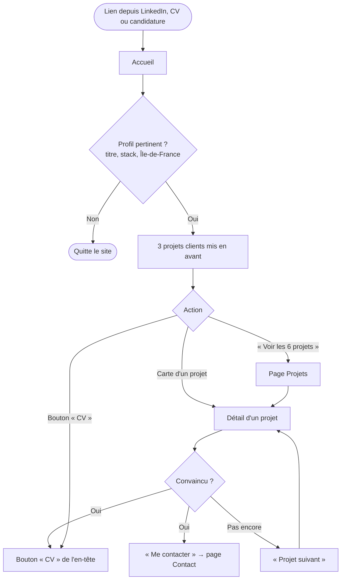
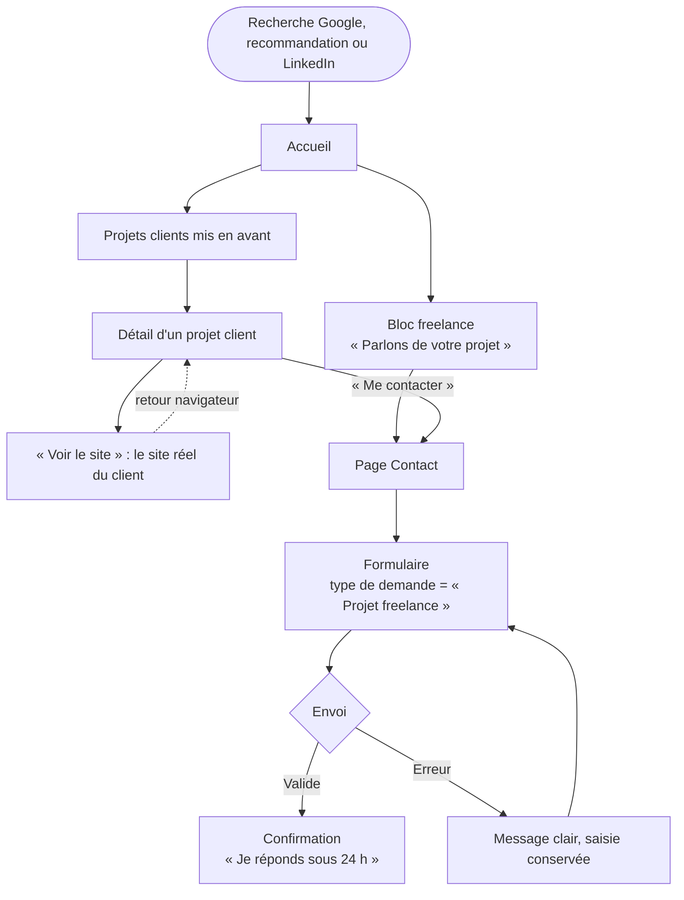
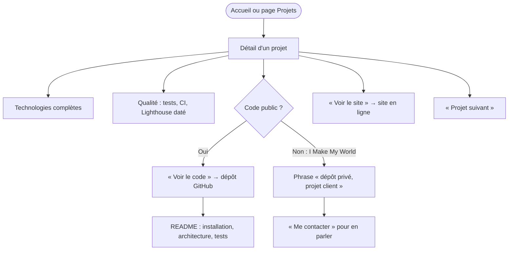
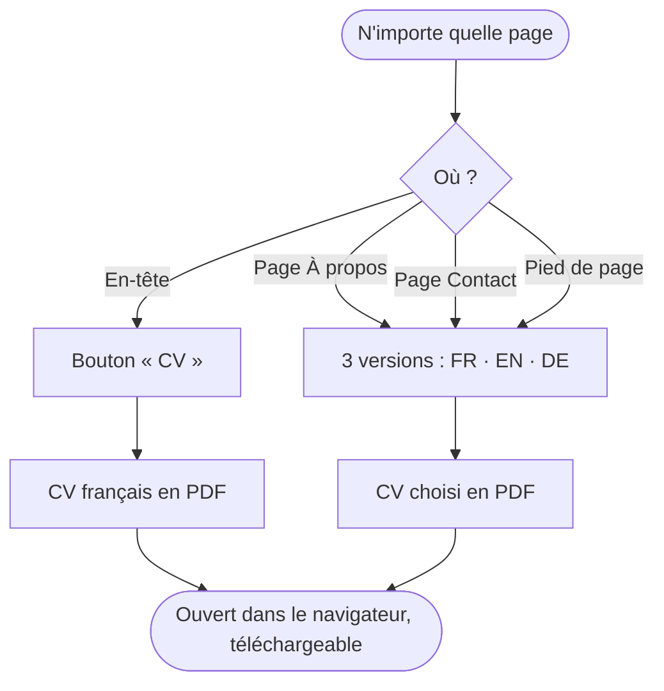
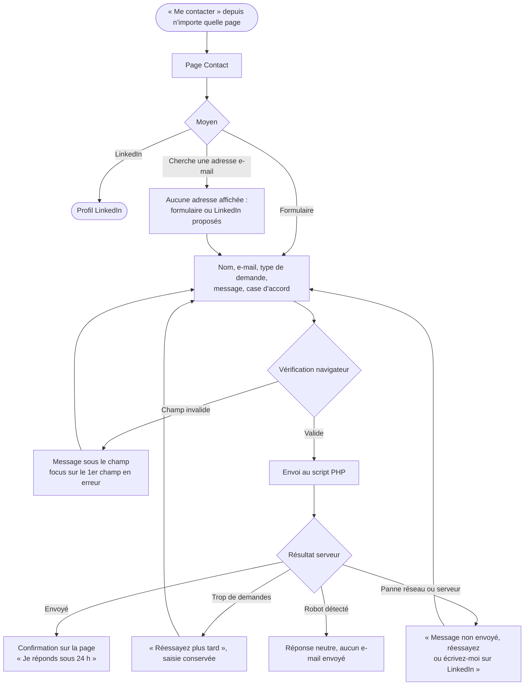

# Parcours utilisateurs (user flows) — Portfolio de Awad Ahmed

> Statut : **validé par Awad le 22/11/2026**. Aucune implémentation n'est commencée.
> Sources : [`product-discovery.md`](./product-discovery.md), [`requirements.md`](./requirements.md), [`sitemap.md`](./sitemap.md).
> Rappels qui s'appliquent à tous les parcours : site 100 % en français ; l'adresse e-mail d'Awad n'apparaît nulle part ; liens externes dans le même onglet ; bouton « CV » dans l'en-tête de chaque page.
> Les améliorations proposées sont marquées **[P1]**, **[P2]**… et regroupées à la fin.

---

## Parcours 1 — Un recruteur découvre le profil et consulte les réalisations

**Visiteur** : recruteur ou RH, souvent depuis LinkedIn ou une candidature, 30 secondes à 2 minutes.
**But** : savoir vite si le profil correspond à une offre, puis garder une trace (CV, contact).

**Étapes**

| # | Le visiteur… | Le site… |
|---|---|---|
| 1 | arrive sur l'accueil | affiche en un écran : photo, nom, titre, stack, Île-de-France, deux boutons |
| 2 | parcourt la page | montre les 3 projets clients avec badge, technologies et lien « Voir le site » |
| 3 | ouvre un projet | affiche le rôle d'Awad, les technologies, les tests et les scores Lighthouse datés |
| 4 | se décide | trouve le CV dans l'en-tête et « Me contacter » en bas de chaque détail |

**Points de friction**
- Le recruteur ne lit souvent que le premier écran : si la stack et la disponibilité (emploi et/ou freelance) n'y sont pas, il part.
- Les termes techniques (CI, Lighthouse, RLS) ne lui parlent pas forcément.
- Il veut savoir si Awad est disponible et pour quel type de poste ; rien ne le dit explicitement aujourd'hui **[P1]**.
- Sur mobile, les captures d'écran de sites peuvent être petites et peu lisibles.

**Améliorations possibles**
- Afficher dès le premier écran une ligne de disponibilité : « Ouvert aux postes en CDI et aux missions freelance » **[P1]**.
- Dans chaque carte, une phrase de résultat en langage simple avant les technologies (« Réservation en ligne utilisée par un technicien à domicile »).
- Expliquer les preuves techniques en une phrase lisible par un non-technicien (« 63 tests vérifient automatiquement le site à chaque modification »).

---

## Parcours 2 — Un client découvre les services et souhaite prendre contact

**Visiteur** : entrepreneur ou dirigeant de PME, souvent sur mobile, 1 à 3 minutes, ne lit pas de code.
**But** : savoir si Awad peut réaliser son projet, voir des exemples, le contacter.

**Étapes**

| # | Le visiteur… | Le site… |
|---|---|---|
| 1 | arrive sur l'accueil | lui parle en bénéfices dans le bloc freelance |
| 2 | regarde un exemple | montre un projet client réel, avec le site en ligne |
| 3 | décide de prendre contact | propose « Parlons de votre projet » qui mène au formulaire |
| 4 | envoie sa demande | confirme sur la page et rappelle le délai de 24 h |

**Points de friction**
- **Pas de page « Services »** au lancement (fonctionnalité secondaire dans la Product Discovery) : le client doit deviner ce qu'Awad propose à partir des projets **[P2]**.
- Le vocabulaire des fiches projets est technique ; un entrepreneur cherche « ce que ça m'apporte ».
- « Voir le site » quitte le portfolio dans le même onglet : le client doit revenir avec le bouton retour.
- Il ne sait pas comment se passe une collaboration (premier échange, devis, délais) ni s'il y a un budget minimum.

**Améliorations possibles**
- Ajouter dans le bloc freelance de l'accueil une courte liste de ce qu'Awad réalise (site vitrine, réservation en ligne, boutique, application sur mesure, back-office), en attendant une vraie page Services **[P2]**.
- Ajouter 3 étapes simples « Comment je travaille » : échange gratuit → devis → réalisation et mise en ligne **[P3]**.
- Pré-sélectionner « Projet freelance » dans le formulaire quand on arrive depuis le bloc freelance (adresse `/contact/?demande=freelance`) **[P4]**.

---

## Parcours 3 — Un visiteur consulte un projet et veut ses détails techniques

**Visiteur** : développeur, lead tech ou CTO qui prépare un entretien, 5 à 15 minutes, va souvent sur GitHub.
**But** : juger la qualité technique : architecture, choix, tests, code.

**Étapes**

| # | Le visiteur… | Le site… |
|---|---|---|
| 1 | ouvre le détail d'un projet | affiche technologies, fonctionnalités, preuves de qualité datées |
| 2 | veut vérifier | donne le lien vers le dépôt GitHub (si public) et le site en ligne |
| 3 | lit le code | trouve un README clair dans chaque dépôt |
| 4 | continue | passe au projet suivant ou contacte Awad |

**Points de friction**
- Le détail ne dit pas **pourquoi** ces choix techniques (ex. Supabase avec RLS, export statique) ; c'est ce qu'un CTO cherche **[P5]**.
- **I Make My World** : pas de code visible ; le visiteur peut penser qu'on lui cache quelque chose.
- Les chiffres (tests, Lighthouse) vieillissent : un CTO qui relance Lighthouse peut trouver un autre score.
- Quitter vers GitHub dans le même onglet coupe la lecture.

**Améliorations possibles**
- Ajouter dans chaque détail une partie « Choix techniques » : 2 ou 3 décisions avec leur raison en une phrase **[P5]**.
- Pour I Make My World : expliquer « code privé, projet client » et proposer une démonstration du code en entretien.
- Afficher la date de chaque mesure (déjà prévu) et la mesurer de nouveau avant chaque mise à jour du portfolio.

---

## Parcours 4 — Un visiteur souhaite télécharger le CV

**Visiteur** : surtout recruteur ; parfois recruteur étranger (CV en anglais ou en allemand).
**But** : obtenir le CV en PDF, dans la bonne langue, en un clic.

**Étapes**

| # | Le visiteur… | Le site… |
|---|---|---|
| 1 | cherche le CV | le montre dans l'en-tête de chaque page |
| 2 | clique | ouvre le CV français (PDF), lien annonçant le format et la taille |
| 3 | veut une autre langue | trouve les 3 versions dans À propos, Contact et le pied de page |

**Points de friction**
- Un recruteur étranger clique sur « CV » dans l'en-tête et reçoit le CV français ; il doit savoir que les autres langues existent ailleurs **[P6]**.
- Sur mobile, un PDF qui s'ouvre fait quitter la page ; revenir n'est pas toujours évident.
- Un CV qui n'est pas à jour avec le site (projets, chiffres) crée une contradiction.

**Améliorations possibles**
- Dans l'en-tête, garder « CV » direct ; sur la page À propos et la page Contact, une mention visible en français : « CV disponible en français, en anglais et en allemand » **[P6]** (le site reste 100 % en français).
- Nom de fichier clair et stable (`awad-ahmed-cv-fr.pdf`) pour que le fichier téléchargé soit reconnaissable.
- Vérifier, à chaque mise à jour du portfolio, que les 3 CV disent la même chose que le site.

---

## Parcours 5 — Un visiteur souhaite le contacter (formulaire ou e-mail)

**Visiteur** : recruteur ou client.
**But** : envoyer un message et être sûr qu'il est bien arrivé.

**Décision existante** : l'adresse e-mail d'Awad n'est affichée nulle part (Product Discovery, D7). Le contact se fait **par le formulaire ou par LinkedIn**. Le formulaire envoie bien un e-mail à Awad, mais sans révéler son adresse.

**Étapes**

| # | Le visiteur… | Le site… |
|---|---|---|
| 1 | ouvre Contact | affiche le formulaire, LinkedIn, GitHub, le CV et « Je réponds sous 24 h » |
| 2 | remplit le formulaire | vérifie chaque champ, avec des messages clairs en français |
| 3 | envoie | désactive le bouton pendant l'envoi, puis confirme sur la page |
| 4 | en cas de problème | garde la saisie et propose LinkedIn en secours |

**Points de friction**
- Certains visiteurs préfèrent écrire depuis leur propre messagerie et cherchent une adresse e-mail **[P7]**.
- Après l'envoi, le visiteur n'a aucune trace de son message (pas d'accusé de réception) **[P8]**.
- La case d'accord obligatoire ajoute un clic ; mal formulée, elle peut inquiéter.
- Le délai « 24 h » est une promesse : s'il n'est pas tenu, il nuit à l'image.

**Améliorations possibles**
- Ne pas afficher l'adresse (décision D7), mais dire clairement sur la page : « Pour me joindre : ce formulaire ou LinkedIn » ; le formulaire reste le moyen le plus simple **[P7]**.
- Envoyer au visiteur un e-mail automatique de confirmation contenant une copie de son message ; l'adresse d'envoi est une adresse technique, pas l'adresse personnelle d'Awad **[P8]**.
- Formuler la case d'accord simplement : « J'accepte que mes données servent uniquement à répondre à ma demande. »

---

## Synthèse des améliorations proposées

| # | Amélioration | Parcours | Effort | Ma recommandation |
|---|---|---|---|---|
| P1 | Ligne de disponibilité dès le premier écran (« Ouvert aux postes en CDI et aux missions freelance ») | 1 | Faible | **Oui, au lancement** (texte exact à valider par Awad) |
| P2 | Liste courte des réalisations possibles dans le bloc freelance de l'accueil | 2 | Faible | **Oui, au lancement** |
| P3 | 3 étapes « Comment je travaille » | 2 | Faible | **Oui, au lancement**, sur l'accueil ou la page Contact |
| P4 | « Projet freelance » présélectionné depuis le bloc freelance | 2 | Faible | **Oui** |
| P5 | Partie « Choix techniques » dans chaque détail de projet | 3 | Moyen (textes à écrire) | **Oui, au lancement** : c'est ce qui convainc un CTO |
| P6 | Mention visible des CV anglais et allemand | 4 | Faible | **Oui** |
| P7 | Phrase claire « formulaire ou LinkedIn » à la place d'une adresse e-mail | 5 | Faible | **Oui** |
| P8 | E-mail automatique de confirmation au visiteur | 5 | Moyen (script PHP) | **Après le lancement** : utile, mais ce message pourrait être utilisé pour envoyer du spam à des tiers ; à faire avec des limites strictes |

**À valider par Awad** : quelles améliorations retenir pour le lancement, et le texte exact de la disponibilité (P1) : CDI seulement, CDI ou CDD, alternance, freelance ?

## Décisions d'Awad (22/11/2026)

- **Disponibilité (P1)** : « Ouvert aux postes en CDI ou CDD et aux missions freelance. »
- **Retenues pour le lancement** : P1, P2, P3, P4, P5, P6, P7 (reportées dans `requirements.md` et `sitemap.md`).
- **Après le lancement** : P8 (e-mail automatique de confirmation au visiteur), avec des limites strictes contre l'envoi de spam.
